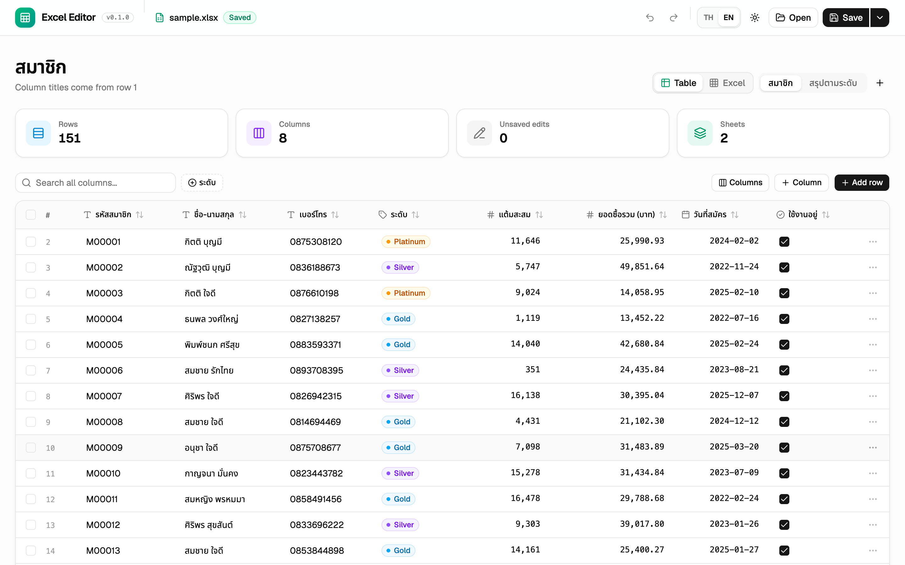
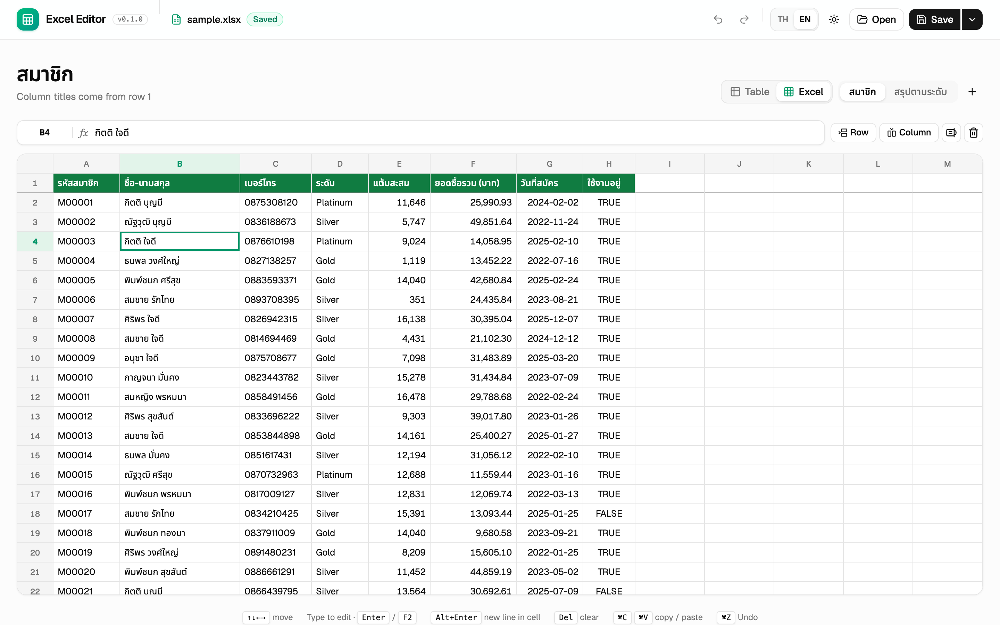
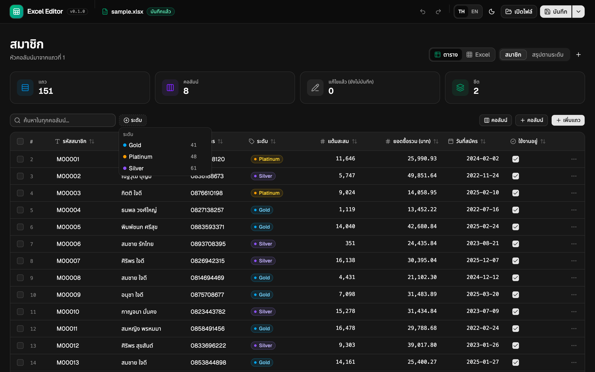
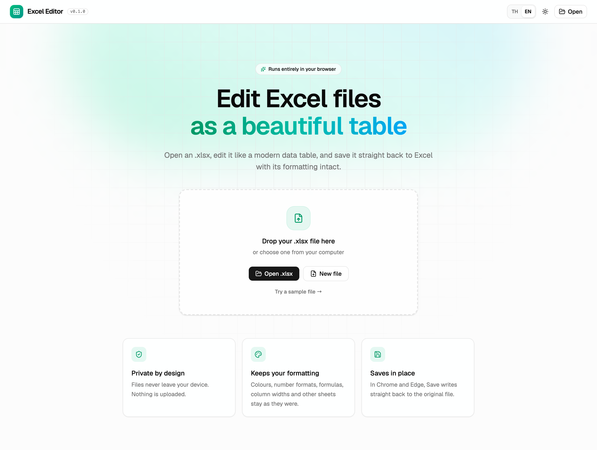

<div align="center">


# Excel Editor

**Edit Excel files in your browser, as a clean data table or a familiar spreadsheet, and save them straight back to `.xlsx` with formatting intact.**

[](https://github.com/dayth36386/excel-editor/actions/workflows/deploy.yml)
[](LICENSE)


### [▶ Live demo: excel-editor-two.vercel.app](https://excel-editor-two.vercel.app/)

Open your own `.xlsx` or click **Try a sample file**. Everything runs in your browser and files are never uploaded.

</div>



## Features

- **Two views of the same workbook.** Switch at any time; edits and undo history are shared.
  - **Table** is a shadcn-style data table with search, sorting, pagination, row selection, column visibility and coloured badges plus filters for category columns (status, tier…).
  - **Excel** is a spreadsheet grid with A/B/C column headers, row numbers, the file's own fills, fonts and number formats, frozen panes, a formula bar and a right-click menu.
- **Your formatting survives.** Edits are written into the original workbook, so colours, number formats, formulas, column widths, frozen panes and other sheets are kept when you save.
- **Save in place.** In Chrome and Edge, Save overwrites the file you opened. Other browsers download a copy.
- **Private.** Files are read and written in your browser. Nothing is uploaded and there is no backend.
- **Excel-like input.** Numbers, dates (`yyyy-mm-dd`), `TRUE`/`FALSE` and `=FORMULAS` are recognised. Values with leading zeros, such as phone numbers, stay text, and `'0123` forces text.
- **Paste from Excel / Google Sheets.** A multi-cell paste goes into the grid as one undo step.
- **Rows, columns and sheets.** Insert, delete, rename and add them, with undo and redo.
- **Thai / English UI** and **light / dark / system** themes, remembered per browser.

## Screenshots

|                   Excel view                   |          Thai UI · dark mode · category filter          |
| :--------------------------------------------: | :-----------------------------------------------------: |
|  |  |

<details>
<summary>Landing page</summary>



</details>

## Getting started

No install needed to try it: **https://excel-editor-two.vercel.app/**. To run it locally:

Requires Node.js 20.19+ or 22.12+.

```bash
git clone https://github.com/dayth36386/excel-editor.git
cd excel-editor
npm install
npm run dev
```

Open http://localhost:5173, then drop an `.xlsx` file on the page or click **Try a sample file**.

### Scripts

| Command                           | What it does                                       |
| --------------------------------- | -------------------------------------------------- |
| `npm run dev`                     | Start the dev server                               |
| `npm run build`                   | Type-check and build to `dist/`                    |
| `npm run preview`                 | Serve the production build                         |
| `npm test`                        | Run the unit tests (Vitest)                        |
| `npm run lint` / `lint:fix`       | ESLint                                             |
| `npm run format` / `format:check` | Prettier                                           |
| `npm run check`                   | Type-check, lint, format check and tests in one go |
| `npm run sample`                  | Regenerate `public/sample.xlsx`                    |

## Keyboard shortcuts

|                      | Table view                                                                       | Excel view                                        |
| -------------------- | -------------------------------------------------------------------------------- | ------------------------------------------------- |
| Edit a cell          | Click it                                                                         | Start typing, or <kbd>Enter</kbd> / <kbd>F2</kbd> |
| Save the cell        | <kbd>Enter</kbd>                                                                 | <kbd>Enter</kbd> (moves down)                     |
| Next / previous cell | <kbd>Tab</kbd> / <kbd>Shift</kbd>+<kbd>Tab</kbd>                                 | <kbd>Tab</kbd>, arrow keys                        |
| Cancel               | <kbd>Esc</kbd>                                                                   | <kbd>Esc</kbd>                                    |
| New line in a cell   |                                                                                  | <kbd>Alt</kbd>+<kbd>Enter</kbd>                   |
| Clear a cell         |                                                                                  | <kbd>Delete</kbd>                                 |
| Copy / paste         |                                                                                  | <kbd>⌘/Ctrl</kbd>+<kbd>C</kbd> / <kbd>V</kbd>     |
| Undo / redo          | <kbd>⌘/Ctrl</kbd>+<kbd>Z</kbd> / <kbd>⌘/Ctrl</kbd>+<kbd>Shift</kbd>+<kbd>Z</kbd> | same                                              |
| Save file / Save as  | <kbd>⌘/Ctrl</kbd>+<kbd>S</kbd> / <kbd>⌘/Ctrl</kbd>+<kbd>Shift</kbd>+<kbd>S</kbd> | same                                              |
| Open a file          | <kbd>⌘/Ctrl</kbd>+<kbd>O</kbd>                                                   | same                                              |

## How it works

- [ExcelJS](https://github.com/exceljs/exceljs) loads the workbook into memory, and that workbook is the single source of truth. Every edit changes its cells directly, so on save everything you didn't touch is written back as it was.
- In the table view, the first non-empty row of a sheet is used as the column titles.
- Formulas are not recalculated in the browser. The saved file is flagged so Excel recalculates it when opened.
- ExcelJS (~1 MB) is loaded only when the first file is opened, so the page itself stays small.

### Limitations

- Only `.xlsx` is supported. Legacy `.xls` isn't, and `.xlsm` macros would be lost.
- Charts and pivot tables are dropped on save (an ExcelJS limitation).
- Inserting or deleting rows and columns does not rewrite references inside formulas.
- The Excel view selects one cell at a time; range selection is not implemented yet.

## Tech stack

[Vue 3](https://vuejs.org) · [Vite](https://vite.dev) · [TypeScript](https://www.typescriptlang.org) · [Tailwind CSS v4](https://tailwindcss.com) · [shadcn-vue](https://www.shadcn-vue.com) / [Reka UI](https://reka-ui.com) · [TanStack Table](https://tanstack.com/table) · [ExcelJS](https://github.com/exceljs/exceljs) · [vue-i18n](https://vue-i18n.intlify.dev) · [VueUse](https://vueuse.org) · [Lucide](https://lucide.dev) · [vue-sonner](https://vue-sonner.vercel.app) · [Vitest](https://vitest.dev)

```
src/
├─ App.vue                     # layout, landing page, header, view switch
├─ components/
│  ├─ DataTable.vue            # table view (TanStack Table + shadcn-vue)
│  ├─ SheetView.vue            # Excel view: formula bar, toolbar, context menu
│  ├─ SpreadsheetGrid.vue      # virtualised spreadsheet grid
│  ├─ DialogHost.vue           # confirm / prompt dialogs
│  └─ ui/                      # shadcn-vue components (generated)
├─ composables/useWorkbook.ts  # workbook state, edits, undo/redo, save
├─ lib/                        # Excel value parsing/formatting, row/column ops, file access, clipboard
└─ i18n/                       # en.ts / th.ts messages
```

## Deployment

The app is fully static (`npm run build` → `dist/`), so it can be hosted anywhere. The live demo at https://excel-editor-two.vercel.app/ is deployed from `main`. This repo deploys to **Vercel** through GitHub Actions ([`.github/workflows/deploy.yml`](.github/workflows/deploy.yml)):

1. Every push and pull request runs `npm run check`.
2. On `main`, [semantic-release](https://semantic-release.gitbook.io) reads the commit messages, tags a new version and publishes a GitHub Release. The version is shown next to the app name.
3. The app is built with the Vercel CLI and deployed: `main` to production, pull requests to a preview URL.

To set it up on your own fork:

1. Link the project once: `npx vercel link`. This creates `.vercel/project.json` (git-ignored).
2. Add these repository secrets under **Settings → Secrets and variables → Actions**:
   - `VERCEL_TOKEN`: create one at https://vercel.com/account/tokens
   - `VERCEL_ORG_ID`: `orgId` from `.vercel/project.json`
   - `VERCEL_PROJECT_ID`: `projectId` from `.vercel/project.json`
3. Push to `main`.

Vercel's own Git deployments are disabled in [`vercel.json`](vercel.json) so that each commit deploys only once. Commit messages follow [Conventional Commits](https://www.conventionalcommits.org): `feat:` bumps the minor version, `fix:` the patch, `feat!:` the major.

## Contributing

Issues and pull requests are welcome. A pre-commit hook (Husky + lint-staged) runs ESLint and Prettier on staged files, and a pre-push hook runs the type check and tests.

## Author

Built by **Dechawiwatwong Detchang** · [@dayth36386](https://github.com/dayth36386)

Thanks to the maintainers of ExcelJS, shadcn-vue, Reka UI, TanStack Table and the other open-source projects listed above.

## License

[MIT](LICENSE) © 2026 Dechawiwatwong Detchang
